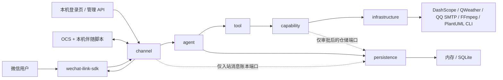
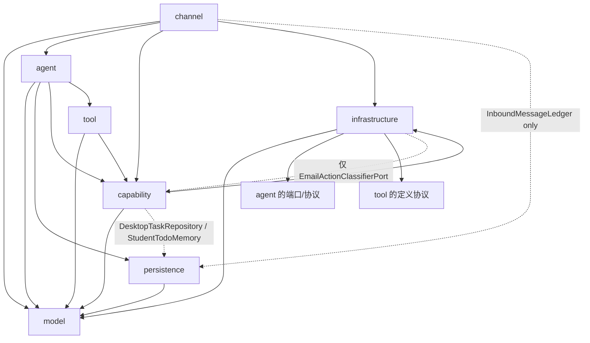

# WeChat Claw 架构

本文描述当前已经实现的模块化单体。它不是微服务集合，也不是传统的
Controller → Service → ServiceImpl → Manager 机械分层。划分模块的依据是变化原因：渠道、Agent 编排、
用户能力、工具协议、外部基础设施、持久化和稳定模型可以由不同成员分别演进。

AI SDK 的单独选型依据见 [SDK 选型记录](sdk-selection.md)，日常开发约束见
[AGENTS.md](../AGENTS.md)。

## 1. 系统边界



外部 `wechat-ilink-sdk` 是依赖，不是本项目的一部分。所有 SDK Client、消息类型、登录上下文和发送方法都被
限制在 `channel/ilink`，其他模块只看到 `AgentRequest`、`AgentReply`、`WechatSession` 等稳定模型。

系统目前只支持微信 iLink Channel。多渠道、动态 Skill、通用计划任务和多 Agent 尚未实现。微信 Bot
不能任意主动发送；任何出站内容都必须绑定一条真实入站消息提供的有效消息 Token。
产品的默认信任边界是“用户在自己的电脑上扫码登录 Bot，并从真实微信入站会话发出指令”。低风险、可确认的
本机动作应保持零白名单配置；静态 allowlist 只作为多用户或特殊部署的可选加固。涉及对外发送、付费或不可逆
副作用的能力仍需独立审批、目标限制和审计，不能从这一本机信任边界自动推导授权。
本机桌面任务 V1 仅支持在 Bot 所在 Windows 电脑上、由创建任务的真实微信会话二次确认后打开经过格式校验的
HTTPS 网址；它不是通用远程桌面、Shell 或 GUI 自动化能力。静态会话和主机 allowlist 是可选的部署加固，
不是自托管单用户场景的启用条件。

可选的 OCS 桥接同样只监听本机 HTTP 接口。OCS 及其平台适配代码不进入本仓库；Claw 提供单独安装的伴随脚本，
通过回环地址和非秘密的专用请求头领取学习命令。该接口不开放 CORS，专用头用于阻止普通网页发起跨站调用；
本机同一用户权限下的其他进程属于宿主机信任边界。OCS 学习任务通过 Desktop 端口打开系统默认浏览器；服务端
不启动隔离浏览器，也不读取或复制浏览器 Cookie。独立的只读课程查询登录由 Infrastructure 使用同一个有界 HTTP
会话加载学习通官方登录页、提取短时二维码并轮询官方扫码状态，二维码以内存媒体交给 Channel 回复，不读取桌面
截图目录，也不把二维码或 Cookie 持久化。只读任务查询保留课程列表条目中的课程专属 `cpi`，并从课程详情页
提取作业列表专用 `workEnc`，不把登录账号 `uid` 当成任务接口参数；缺少课程查询标识或上游无权限时明确失败。
用户明确说出课程名称后，Capability 打开经过
校验的回环控制台，控制台验证伴随脚本已经连接后才继续到学习通课程列表。伴随脚本在同一标签页的已登录浏览器
中识别学习通 Passport、课程入口内登录表单和学校 SSO；未登录时保持 `WAITING_LOGIN`，登录跳转完成后继续从
HTML 课程卡片或官方 `channelList` JSON 按名称/课程引用定位课程，常驻面板显示真实阶段，再把 HTML5
视频进度、页面标题和浏览器可见字幕上报。JSON 解析限制响应字符数、课程数、文本长度和纯数字标识，只生成固定
学习通主机上的语义课程地址，不把整份课程数据回传服务端。
这条明确指令本身是本次打开课程的授权，不复用通用桌面任务的二次确认。学习会话保持创建者归属，状态有容量和
有效期上限且只保存在进程内；静态会话和主机限制为可选部署加固。

## 2. 模块职责

| 模块 | 负责 | 不负责 |
|---|---|---|
| `channel` | 登录、轮询、入站规范化、出站投递、媒体下载、SDK 类型转换、HTTP 渠道接口 | 模型协议、工具选择、业务能力实现 |
| `agent` | 上下文、意图、模型端口、模型选择、工具循环、自然引用、用户输出渲染、失败降级、会话串行 | 微信 SDK、厂商 SDK、SMTP/HTTP 细节 |
| `capability` | 用户能感知的完整天气、文档/演示文稿、图片/语音、二维码、图表、情感画像、文件、邮件和 OCS 学习会话行为及安全策略 | Function Calling 协议、微信消息类型 |
| `tool` | `AgentTool` SPI、工具定义、Schema、注册、参数反序列化和执行上下文 | 模型厂商对象、网络和持久化 |
| `infrastructure` | DashScope、QWeather、QQ SMTP、FFmpeg、PlantUML CLI、HTTP 安全、限流、线程池、JSON | Agent 业务编排和渠道行为 |
| `persistence` | 会话记忆、学生待办、最近图片/文件短期引用、入站消息账本、SQLite 配置和 Mapper | 模型调用和渠道 SDK |
| `model` | 跨模块稳定且有业务含义的数据结构 | 业务流程、网络、数据库访问 |

同一模块内部不再为了依赖注入机械增加接口。只有真实的可替换边界才使用接口：

- `WechatChannel` 隔离渠道；
- `AgentModelClient` 隔离模型 Provider；
- `AgentTool` 隔离工具；
- `ConversationMemory` 隔离内存和 SQLite；
- `InboundMessageLedger` 只保存渠道入站的去重/租约元数据；
- `EmailActionClassifierPort` 是 Capability 拥有的语义端口：模型端点在 infrastructure 实现，
  Capability 内的 IMAP 适配器消费它判断邮件是否需要行动。

`EmailActionClassifierPort` 是依赖方向的唯一 Capability 端口例外。Capability 不能依赖 agent 的
`AgentModelClient`，而“邮件是否需要行动”的语义判断又必须由模型完成，因此端口归 Capability 所有、
实现在 infrastructure。架构测试只批准这一个语义端口（连同它的稳定异常类型），不放开整个模块。

### Agent 工具编排

通用工具调用由模型负责语义判断：`AgentRuntime` 将当前会话的有限上下文和服务端确认可用的工具定义交给
`AgentToolLoop`，模型决定是否调用工具、选择工具及调用顺序。循环执行工具后，会把文本结果和可供模型理解的
图片媒体作为 `tool` 消息送回模型，再由模型决定继续调用还是输出最终回复。

模型只提出调用意图，不能绕过服务端边界。`ToolRegistry` 负责工具名和 Schema 校验，Capability 负责权限、审批、
路径、身份、Token、配额、超时和副作用约束；禁用工具不会进入模型目录。邮件发送、电脑任务、微信回复上下文和
自然引用仍由服务端强制校验，不能由模型文字替代。

Detector 只提供兼容性提示、自然引用解析和安全上下文，不再把普通语义判断转换成通用工具的必需顺序。依赖型动作
在每个工具结果返回后再由模型决定下一步；单次运行仍受最大轮次、结果字符数、媒体数量和总时长限制。

本机文件搜索的语义理解完全由模型承担：`browse_files` 的输入是结构化字段（文件名关键词、文件类型、目录提示、
排序、是否只列目录、是否指代最近收到的文件），模型负责把自然语言翻译成这些字段并给出同义/相关关键词；
`FileBrowseQueryCompiler` 只做长度、数量、路径和扩展名的确定性校验，不做自然语言解析。文件名命中任一关键词
即返回，并按命中关键词数量排序，因此“课表”和“课程表”这类同义表达不再依赖正则猜词。

邮件“是否需要行动”的语义判断通过 `EmailActionClassifierPort` 批量交给模型：一次请求分类有界的一批邮件主题，
带独立超时、队列和并发上限；模型不可用、超时、返回结构不合法或数量不匹配时，IMAP 适配器逐封回退到确定性
`EmailActionClassifier`，不会因为模型失败而丢失所有候选。

情感画像标记从“情绪词+上下文”扩展为“情绪词+结构化情绪等级+上下文”：
`[EMOTION: 情绪词] [MOOD: low|neutral|positive] [CONTEXT: 话题摘要]`。情绪等级由模型输出，
主动关怀调度器只检查 `[MOOD: low]` 标记，不再用负面词正则猜测情绪。

生成图片以内存短期记忆绑定会话，下一轮请求会在当前消息没有新视觉附件时附带最近图片；工具循环中的图片结果也
会直接进入下一次模型请求。图片大小、数量和过期时间均受配置限制，不把临时 URL、Token 或本机路径写入会话历史。

## 3. 依赖方向

源码依赖遵循下图。箭头表示“编译时允许依赖”。



需要特别区分运行时调用和编译时依赖：`AgentRuntime` 运行时调用 `AgentModelClient`，但
`DashScopeModelClient` 在 `infrastructure` 中实现该端口，因此 Agent 源码从不导入厂商类型。

强制边界由 `ArchitectureRuleTest` 自动检查：

- 根业务包下只有七个职责模块；
- `wechat-ilink-sdk` 类型只在 `channel/ilink`；
- DashScope 类型只在 `infrastructure`；
- POM 只能存在一个 AI SDK；
- `tool` 不得依赖 `agent/channel/infrastructure/persistence`；
- `agent` 不得依赖 `channel/infrastructure`；
- `channel` 只能通过 `InboundMessageLedger` 使用持久化入站状态，不能读取会话记忆、Mapper 或业务仓储；
- `infrastructure` 不得依赖 `capability`，唯一例外是语义端口 `EmailActionClassifierPort`
  （连同 `EmailClassificationUnavailableException`）；
- SQL 不得出现在 Java 源码。

## 4. 微信入站时序

```mermaid
sequenceDiagram
    participant SDK as wechat-ilink-sdk
    participant Session as IlinkBotSession
    participant Dispatch as IlinkMessageDispatcher
    participant Ledger as InboundMessageLedger
    participant Normalize as IlinkInboundNormalizer
    participant Handler as IlinkMessageHandler
    participant Runtime as AgentRuntime
    participant Loop as AgentToolLoop
    participant Model as AgentModelClient
    participant Registry as ToolRegistry
    participant Memory as ConversationMemory
    participant Reply as IlinkReplySender

    SDK->>Session: 回调 WeixinMessage 列表（含消息 Token）
    Session->>Dispatch: dispatch
    Dispatch->>Dispatch: 入站限流 + 按会话 FIFO
    Dispatch->>Ledger: 执行前按 bot_id + message_id 领取租约
    Ledger-->>Dispatch: CLAIMED / BUSY / COMPLETED / DEAD
    Dispatch->>Handler: 后台工作线程 + 可信回复上下文
    Handler->>Normalize: SDK 类型转稳定消息
    Normalize-->>Handler: AgentRequest
    Handler->>Runtime: run
    Runtime->>Memory: 读取并裁剪历史
    Runtime->>Runtime: 解析意图、工具范围和输出偏好
    Runtime->>Loop: 模型消息 + 可用工具
    loop 最多 max-tool-rounds
        Loop->>Model: complete(ModelRequest)
        Model-->>Loop: 文本或工具调用
        opt 返回工具调用
            Loop->>Registry: 校验名称、Schema、上下文并执行
            Registry-->>Loop: 工具结果和可选媒体
        end
    end
    Loop-->>Runtime: 最终文本和媒体
    Runtime->>Memory: 保存用户/助手消息
    Runtime-->>Handler: AgentReply
    Handler->>Reply: AgentReply + 当前入站回复上下文
    Reply->>Reply: 校验 Bot 会话、目标和消息 Token
    Reply->>SDK: 使用消息 Token 回复文字 / 图片 / 文件 / 语音 / 视频
```

`IlinkSessionRegistry` 只管理会话集合和对外操作；每个 `IlinkBotSession` 单独拥有 SDK Client、二维码、
登录状态和轮询循环。消息规范化、Agent 调用和回复投递也分别在三个组件内，避免所有成员共同修改一个巨型
Channel 类。

消息 Token 是微信 Channel 的临时授权材料，只能用于它所属的入站消息回复流程。它不进入
`AgentRequest`、Tool 参数或持久化层，也不能仅凭用户 ID、会话 ID 或登录 Client 替代。后台任务只允许生成
待回复内容；没有新的入站消息 Token 时不得发送，用户下一次发来消息后才能在新的回复窗口内附带该内容。

异步处理是为了把 SDK 轮询线程与模型、媒体和文件发送的慢操作隔离；同一会话仍由 FIFO 队列串行，不同会话才
使用有界线程池并行。账本只记录 `bot_id`、`message_id`、发送者/会话标识、状态、尝试次数和租约时间，状态包括
处理中、失败待重试、已完成和终止失败。SQLite 默认保留 3 天，处理失败最多重试 5 次，退避从 2 秒增长到 5 分钟。
进程重启后，若 iLink 再次投递同一消息，未过期租约会阻止并发重复处理，过期租约可以被重新领取；已完成消息在 TTL
内直接跳过。内存存储模式只提供进程内去重，不提供重启后的账本恢复。

## 5. Agent 与 Function Calling

`AgentModelClient` 的协议由以下厂商无关对象组成：

- `ModelRequest`：消息、媒体、工具定义、必选工具策略；
- `ModelMessage`：system/user/assistant/tool 消息；
- `ModelResponse`：最终文字和零到多个 `ModelToolCall`；
- `ModelToolCall`：调用 ID、工具名和 JSON 参数。

`DashScopeModelClient` 只负责这些对象与 DashScope SDK 对象之间的双向转换、超时、并发和有限重试。
它不执行工具，也不读取会话记忆。

`AgentToolLoop` 拥有循环，因此安全策略不交给框架或模型：

1. Runtime 将必须完成的动作组织为有序计划，每轮只暴露下一项必需工具；
2. 拒绝未知、禁用或本轮未授权的工具；
3. 按输入 record 生成 JSON Schema，并严格反序列化；
4. 工具调用、工具结果字符数、媒体数量和单次 Run 总时长受预算限制；
5. 相同工具和相同参数在一次 Run 中只能执行一次；
6. 工具失败会立即返回稳定失败，不允许后续模型文字伪造成功；
7. `returnDirect` 只有在没有后续必需工具时才能终止循环；
8. 达到轮次上限、空响应或异常时返回稳定降级结果。

上下文达到 `historyMessages` 或 `maxHistoryCharacters` 边界时，Agent 先进行无损结构压缩：按角色合并较早消息，
不改写其正文，只减少消息边界开销。如果带最近原文仍超出字符上限，才调用同一个 `AgentModelClient`，且摘要请求
不提供工具；摘要只作为标记明确的不可信 user context，不能成为 system message。成功摘要会和最近原文一起保存，
失败则回退到可放入上限的最近原文，不让摘要失败伪造或阻断当前回复。

邮件正文依赖实时天气时，计划固定为 `get_current_weather → send_email`。天气结果无论成功或失败都会作为
Tool Message 进入下一轮；下一轮只授权邮件工具，由邮件 Capability 根据天气是否成功决定准备草稿、澄清或
返回错误。模型返回未在当前阶段暴露的工具名时不会执行。

用户明确要求把最近生成的文件作为邮件附件时，Agent 从会话级有界文件记忆提供服务端持有的字节，
邮件 Capability 将其纳入待确认草稿；QQ SMTP 适配器在确认后使用 MIME 附件发送。文件记忆仅为进程内短期缓存，
不会写入会话数据库。

`ConversationReferenceStore` 在 Agent 内维护会话级、对象类型级和 TTL 级的短期自然引用。文件搜索、待办、
Desktop Task、OCS 会话、课程和刚生成的文件都可以在下一条消息中用“第一个”“刚才那个”“这门课”“当前视频”
继续操作；精确的 `file-*`、`TD-*`、`DT-*`、`OS-*` 和课程映射只在服务端按当前微信会话重新解析并交给能力校验。
引用不进入消息 Token、会话数据库或模型用户历史，过期、会话不一致和对象类型不一致均返回安全失败。

`AgentUserOutputRenderer` 是所有工具结果的手机显示边界。它先捕获可信引用，再把文件搜索 JSON、状态枚举、
课程标记、待办 ID、桌面/OCS ID、工具名和本机绝对路径转换成自然名称、序号、进度及下一句可执行提示；
原始工具 JSON 只留在 Agent 内部，不能作为微信正文或历史回传。

确定性计划由 Runtime 在意图确认后固定排序：文件自然选择后可单独回传微信文件，或先选择为邮件附件再准备草稿；
Office 生成后才能进入邮件草稿；课程引用先解析再启动 OCS；Desktop、OCS 和待办的自然确认/取消/进度查询优先
命中当前会话最近且同类型的对象。当前轮明确请求优先于旧上下文，短句不会跨对象类型续接。

`AgentCapabilityReadiness` 在应用就绪事件中检查文件目录、QQ SMTP 发信、学习通、官方 OCS、OCS 题库来源和 Office
工具，并把稳定诊断码转换成手机可理解的缺失配置或当前可用能力列表；它不在启动时执行外部副作用请求。只读
IMAP 待办来源尚未接入，因此不会被报告为已就绪。

`ToolRegistry` 在启动时注册 Spring Bean 形式的 `AgentTool<?>`。普通单步工具通常只需要一个输入 record、
一个工具类和对应 Capability 方法；需要跨工具顺序保证的文件、邮件、Office、OCS 计划由 Agent Runtime 显式维护。

## 6. Capability 组织方式

Capability 表达用户完成的一件事，不是外部 API 的薄包装。

例如邮件能力同时负责：

- 可用性判断；
- 会话和收件人 allowlist；
- 地址、主题和正文校验；
- 两阶段草稿审批；
- 草稿过期和每小时频率；
- 发送结果不确定时防重复。

QQ SMTP 连接参数和实际网络调用仍在 `infrastructure/mail`。`EmailTool` 只调用
`EmailCapability`，因此更换 SMTP 实现不会影响工具协议。
只读 IMAP 待办来源的“是否需要行动”判断通过 `EmailActionClassifierPort` 批量交给模型，
模型不可用时由确定性 `EmailActionClassifier` 逐封兜底；判断结果只用于待办展示，不参与发送授权。

二维码能力由 `QrCodeCapability` 直接使用 ZXing 生成 PNG。图表能力由
`DiagramCapability` 调用 `infrastructure/diagram` 中的外部 PlantUML CLI；主开关默认开启但仍依赖外部 CLI，源码经过类型、长度、
前处理指令和输出格式校验，模型不能指定可执行文件或临时路径。情感画像由 `EmotionalProfileService` 在进程内维护。
画像从模型回复末尾的 `[EMOTION]/[MOOD]/[CONTEXT]` 标记提取，`MOOD` 是低/中性/积极的结构化等级；
主动关怀调度器只按 `[MOOD: low]` 判定，不再用负面词正则猜测。基于定时器主动发送关怀消息不符合微信消息
Token 约束；调度器最多只能产生待回复状态，等待用户下一次入站消息。

新增能力时按最小改动面放置：

| 需求 | 通常改动 |
|---|---|
| 改微信消息解析或发送 | `channel/ilink` |
| 改模型上下文、路由或降级 | `agent` |
| 增加用户可感知行为 | `capability`，需要模型选择时再加 `tool` |
| 更换外部服务或网络策略 | `infrastructure` |
| 更换记忆存储 | `persistence` 并实现 `ConversationMemory` |
| 增加跨模块数据字段 | 先评审 `model` 合同，再同步消费者 |

不要仅为“目录看起来对称”同时修改七个模块。

经过架构测试批准的持久化例外仅有两个：`DesktopTaskCapability` 可使用
`DesktopTaskRepository` 原子保存用户授权、执行状态和真实结果；`StudentTodoCapability` 可使用
`StudentTodoMemory` 保存会话隔离的学生待办。例外只允许依赖稳定仓储端口，不允许 Capability 导入
MyBatis Mapper、SQLite 实现或 SQL。

本机浏览器适配器只在交互式 Windows 桌面中可用。启用桌面任务的 Java 进程必须使用
`-Djava.awt.headless=false` 启动；适配器的可用性会向 Capability 和 Tool 逐层上报，无头环境不会创建待审批任务。

`OcsStudyCapability` 不依赖 OCS 内部脚本对象。`start_ocs_study` 只有在可信意图解析器识别到本轮明确的 OCS
学习请求时才暴露；它创建服务端会话并打开回环专用启动页。随机启动标识只放在 URL fragment 中，命令必须经过
短时租约和显式确认，因而其他普通标签页不能从 `/api/local/ocs/**` 抢走任务。伴随脚本回传真实页面事件，
`get_ocs_study_status` 再按可信微信会话身份返回真实进度和有界笔记。普通课程查询继续使用只读
`learning_query`，不会获得启动 OCS 会话的权限。只读课程结果在手机上按序号显示，服务端按可信微信会话有界保存
本地课程引用到课程 ID、班级 ID 和 `cpi` 的映射。显式 OCS 请求直接从该映射构造目标地址；引用在应用重启或
清空会话后失效。浏览器不会解释课程引用或依赖页面顺序。课程详情查询还记录最近选中引用，OCS 工具参数漏掉引用
时可在同一可信会话内恢复；名称必须与保存目标
一致，否则拒绝复用。课程列表和详情显示开设起止日期以区分跨学期同名课程。同名课程也不退化为名称猜测。
导航请求本身不产生 `LESSON_CHANGED` 或运行状态，只有目标页面实际加载后的伴随脚本事件才构成页面证据。
伴随脚本本身承担课程目录到章节的导航，并在顶层页面及旧版超星的章节/视频 iframe 中共享标签页会话；它不依赖
第三方 OCS 的页面兼容性或任务点判断。已完成视频也可以作为复习内容重新播放，回传百分比表示当前视频的本次
实际播放位置，不表示学习通课程原有完成率。各工具
直接返回真实结果；短句“继续”仅在近期学习上下文中续接，
近期 OCS 上下文则路由到浏览器学习
会话。课程全部参与只读查询，任务输出有界；学习通未完成任务按截止时间合并进统一待办视图，
`query_todos` 支持来源与自定义时间范围过滤；未明确时间范围时默认只返回一个月内（含逾期）的任务。
OCS 伴随脚本进入课程后会自动打开用户指定的章节，未指定时打开第一个未完成章节。
上游失败或登录失效不会降级为空列表。

回环启动页要求伴随脚本通过显式语义版本握手；只有达到页面要求版本时才显示“已连接”并领取任务。无版本的旧
脚本、低版本脚本和未安装脚本分别显示可操作的更新/安装提示，OCS 状态查询也区分未领取、已领取、等待登录和
课程定位阶段，避免用“当前章节尚未识别”掩盖启动链路故障。

`AgentIntentResolver` 对跨能力切换实行当前轮优先：先汇总当前消息中明确出现的能力意图，只有当前轮没有任何
明确能力时才允许“继续、重试、再来一次”等短句续接；续接归属只看最近一个用户任务，不扫描更早的历史命中。
同一轮明确要求的组合操作（例如生成表格并发邮件）仍可同时路由，旧课程、邮件或媒体上下文不能抢占新的待办、
文件、天气或媒体请求。

学习平台适配器把结构化题目快照交给 Channel；`OcsQuestionAnswerer` 位于 Agent，复用唯一的
`AgentModelClient`，通过必需的结构化工具调用生成 `OcsAnswerCandidate`。在线请求在命名的有界线程池中执行，
具有独立超时、队列和置信度门槛。Capability 根据本轮学习授权和会话次数上限生成 `OcsAnswerDecision`，再由
Channel 转成浏览器可接收的有界语义命令。Agent 只产生选项或填空等语义答案，不能产生脚本、选择器或坐标；
浏览器页面动作和页面反馈分别建模，只有回传 `ANSWER_CORRECT` 等真实事件后才能报告结果。模型输出本身不代表
答题成功。

## 7. 并发和资源

- SDK 轮询运行在命名的有界线程池，不执行模型推理；
- 入站消息先做会话/全局固定窗口限流；
- `IlinkMessageDispatcher` 为每个稳定会话维护 FIFO；
- 入站消息在 FIFO 工作线程真正执行前才领取处理租约，避免长队列等待期间租约提前过期；
- 处理异常按有界指数退避重试，队列执行器短暂拒绝时保留任务并延迟提交；
- `ConversationCoordinator` 再保证同一会话 Agent Run 串行；
- 不同会话在配置的并发上限内并行；
- DashScope 聊天和媒体生成分别有有界并发；
- FFmpeg 子进程有超时、输出大小和生命周期管理；
- 捕获 `InterruptedException` 后恢复中断状态。

会话键使用 `wechat-ilink|bot=<BotID>|user=<普通微信用户ID>`。Bot ID 是租户边界，重新扫码得到不同 Bot
时会创建新的隔离会话，避免不同租户共享历史、画像或待处理任务。开发阶段切换到新键后不迁移旧数据库数据。

## 8. 持久化

`ConversationMemory` 有两个实现：

- `InMemoryConversationMemory`：显式配置时使用，适合临时运行；
- `SqliteConversationMemory`：默认实现，重启后保留历史。

SQLite DDL 位于 [`sqlite-schema.sql`](sqlite-schema.sql)，应用会在启用 SQLite 时自动初始化。Mapper SQL 位于
[`ConversationMessageMapper.xml`](../src/main/resources/mapper/ConversationMessageMapper.xml) 和
[`InboundMessageLedgerMapper.xml`](../src/main/resources/mapper/InboundMessageLedgerMapper.xml)。SQLite 使用 WAL 和单连接写入；
Java Mapper 只声明方法。历史同时受消息条数、字符数和可选 TTL 限制。
历史摘要单独存放在 `bot_conversation_summary`，与最近原文消息分开清理；摘要过期、清空会话或存储切换时不会
混入其他会话。摘要生成失败不写入持久化层。

`ilink_inbound_message` 是消息投递账本，不保存消息正文、媒体字节、context token 或 SDK Client。它用 Bot ID 与消息 ID
做唯一键，避免同一消息在多 Bot 场景下相互去重；会话记忆使用同一 Bot 范围内的
`wechat-ilink|bot=<BotID>|user=<普通微信用户ID>` 键。不同 Bot 即使面对同一普通用户，也会使用不同的
Agent 会话和消息顺序队列。

`GeneratedImageMemory` 是容量和 TTL 均受限的进程内短期记忆，只服务“刚才那张图”的追问，不把临时媒体 URL
写入数据库。SDK 活跃 Client、Token、API Key 和 SMTP 授权码都不得持久化。

## 9. 安全和失败策略

所有微信输入、模型输出、工具参数、文件内容、外部响应和媒体 URL 都视为不可信。

- 下载只允许 HTTPS 和配置的主机，重定向后重新校验；
- 文件名被规范化，不允许模型选择服务器路径；
- 工具默认按可用性和本轮意图缩小暴露范围；
- 邮件、文本文件、PPTX 和图表主开关默认开启，但缺少外部依赖或凭据时仍不会进入可用工具目录；
- 外发邮件必须审批，且 SMTP 尝试不自动重试；
- 微信回复必须使用当前入站消息携带的有效消息 Token，并校验 Bot 会话和目标用户；
- 消息 Token 不写日志、不持久化、不进入 Agent 或 Tool，也不允许后台任务跨消息复用；
- API Key、密码、授权码、临时签名 URL、完整正文和个人标识不写日志；
- Channel 对外错误转换不包含内部路径或上游完整响应；
- 模型/天气/媒体失败会返回明确的本地降级，不伪造工具成功。

HTTP 管理接口目前默认只监听本机，尚未实现管理员身份体系。管理接口不得提供绕过消息 Token 的微信主动发送；
若改变监听地址，必须先增加鉴权、CSRF/等效保护、资源归属校验和审计。

## 10. 当前限制

- 只有微信 iLink Channel；
- iLink SDK 的轮询游标和活跃 Client 仍在进程内；应用在“SDK 已推进游标、业务回调尚未完成”这个极窄窗口内重启时，
  仅靠当前账本无法重建原始消息。完整断点恢复需要上游重新投递或 SDK 提供可安全持久化的游标协议；
- 出站发送仍受 iLink SDK 当前公开发送 API 约束，账本能避免重复处理，不能把外部发送变成严格 exactly-once；
- 只有 DashScope 模型 Provider；
- 情感画像默认是进程内存储，重启后丢失；
- PlantUML 图表工具依赖运维环境中的外部 CLI；
- 扫描版 PDF 没有 OCR；
- 登录 Client 不跨进程恢复，重启后要重新扫码；
- 微信只能在真实入站消息提供的有效 Token 上下文中回复，后台任务不能主动触达用户；
- 没有动态 Skill/Plugin、计划任务、多 Agent 或远程节点；桌面任务仅执行本机 V1 HTTPS URL；
- OCS 桥接 V1 按课程引用或用户提供的课程名称在已登录的学习通课程列表中定位课程，观察学习通子域中的 HTML5
  视频、页面标题和可用字幕；它不直接调用 OCS 私有 API，同名课程且缺少引用时需要用户补充引用或更完整名称，
  应用重启后学习会话丢失；
- 没有管理接口鉴权，因而不应直接暴露到公网。

这些限制应在真正实现前保持明确，不能在接口或 README 中描述为已有能力。
